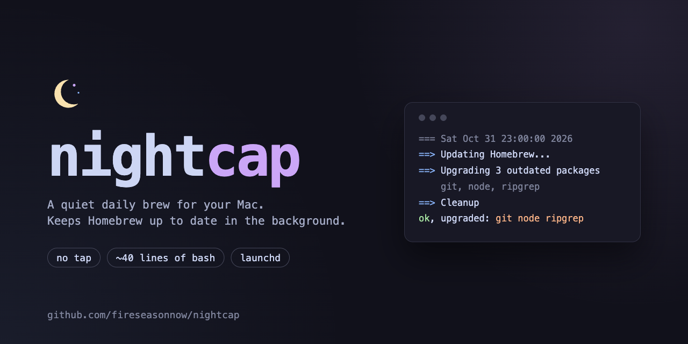

A quiet brew for your Mac: keeps Homebrew up to date in the background on macOS. Daily by default, or weekly, every 2 weeks or monthly if you prefer, it runs:

```
brew update && brew upgrade && brew cleanup
```

It's a ~50-line shell script plus a launchd agent, with no tap and nothing else to trust. Read [`nightcap`](nightcap) before you install it; that's the whole thing.

If you want more options (pick which packages to upgrade, `sudo` prompts for casks and so on), look at [DomT4/homebrew-autoupdate](https://github.com/DomT4/homebrew-autoupdate) instead.

## What it does

- Runs daily, weekly, every 2 weeks or monthly. Checks hourly and at login whether a run is due, so a missed run catches up without running more often than you asked.
- **Runs on battery too**, so updates don't wait for you to plug in.
- **Notifies you only when something fails**, and tries again the next day. Successful runs stay quiet.
- Logs to `~/Library/Logs/nightcap.log`, trimmed to the last 2000 lines. Each run ends with a summary line such as `ok, upgraded: git node ripgrep`, so you can see what changed and when.
- Runs as a low-priority background job.
- Works with Apple Silicon (`/opt/homebrew`) and Intel (`/usr/local`) Homebrew installs.

## Install

```
git clone https://github.com/fireseasonnow/nightcap.git
cd nightcap
./install.sh
```

This copies the script to `~/.local/bin/nightcap` and loads `~/Library/LaunchAgents/io.github.fireseasonnow.nightcap.plist`. The first run starts right away. Running `install.sh` again is safe; it replaces the script and reloads the agent.

## Schedule

`install.sh` takes an optional frequency and an optional time of day in 24-hour format:

| Frequency | Runs |
|---|---|
| `daily` (default) | once a day |
| `weekly` | every 7 days |
| `biweekly` | every 2 weeks |
| `monthly` | once a month |

```
./install.sh                  # daily
./install.sh weekly           # weekly
./install.sh weekly 03:00     # weekly, at 03:00
./install.sh 03:00            # daily, at 03:00
```

There's no default time of day. Without one, the next run is due one period after the last run started, and it can start up to about an hour after that. Late runs carry forward, so the time of day drifts later. With a time, the next run goes back to that time even if the last one ran late.

You can't pick a weekday or a date. Each period is counted from the last run, so `weekly` usually lands on the weekday you installed it, and a late run moves later runs to the new day.

The first time it runs, macOS may show an "App Background Activity" notice. You can manage it in System Settings → General → Login Items & Extensions.

## Uninstall

```
./uninstall.sh
```

Or by hand:

```
launchctl bootout gui/$(id -u)/io.github.fireseasonnow.nightcap
rm ~/Library/LaunchAgents/io.github.fireseasonnow.nightcap.plist
rm ~/.local/bin/nightcap ~/.local/state/nightcap-next-run ~/Library/Logs/nightcap.log
```

## Things to know

- **Sleep and shutdown:** launchd doesn't wake the Mac. If a run comes due while it's asleep or off, it runs once within about an hour of waking, or at login. So a fixed time like `03:00` only actually runs at 3am on a Mac that stays awake overnight; on a laptop that sleeps, it runs after you open the lid.
- **To hold a package back** (a database, a specific language version), run `brew pin <name>`. Pinned packages are skipped by `brew upgrade`, so this script leaves them alone too. `brew unpin <name>` releases it.
- **Casks that need `sudo`** can't upgrade in the background. Those runs fail with a notification each day; run `brew upgrade` in a terminal to finish them.
- **To run it now**, call `~/.local/bin/nightcap` with no arguments. That ignores the schedule and doesn't move the next scheduled run.
- **`brew cleanup` also autoremoves formulae that nothing depends on anymore**, for example a Python version that was only installed as a dependency. To prevent that, add `export HOMEBREW_NO_AUTOREMOVE=1` near the top of the script.
- **Change the schedule** by running `install.sh` again with the new options. That also starts a run right away.

## License

[MIT](LICENSE)
